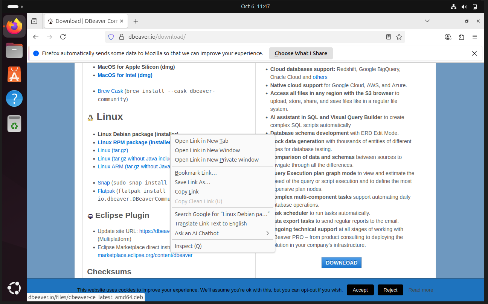
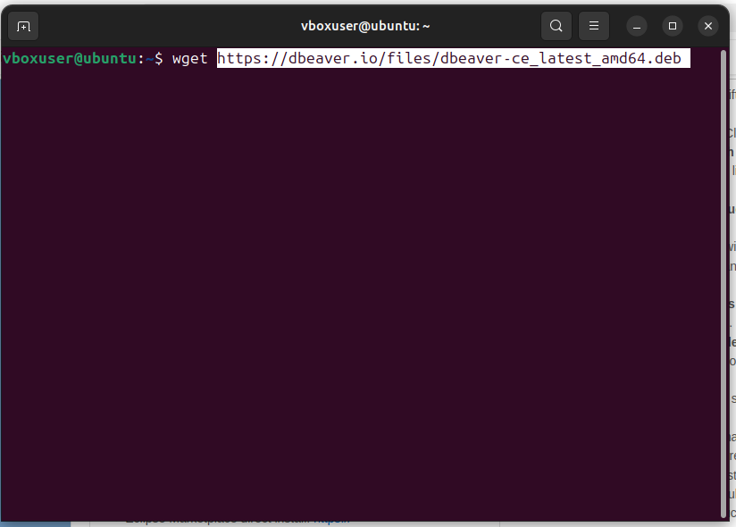
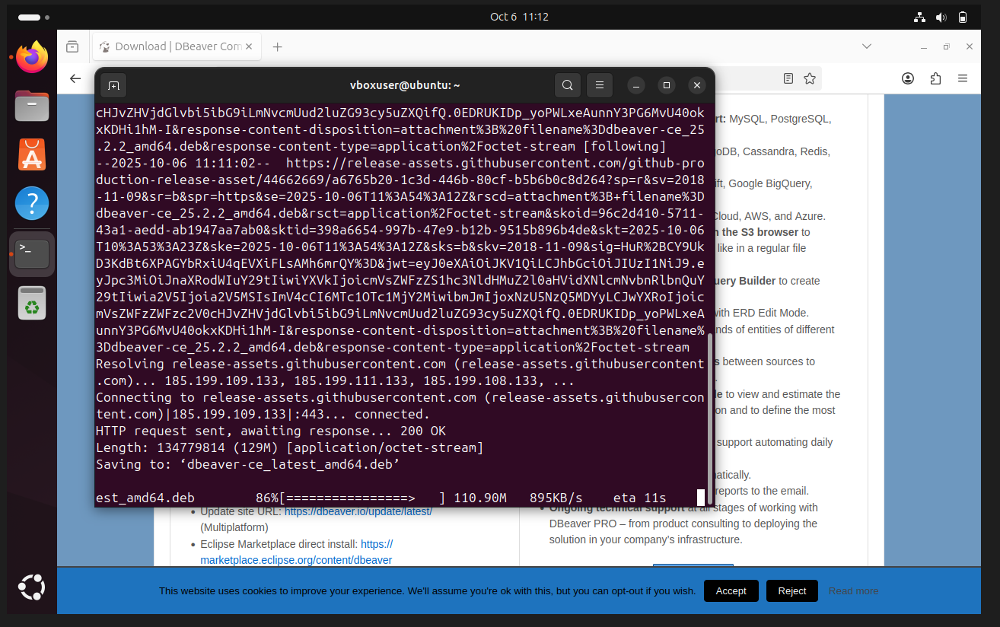
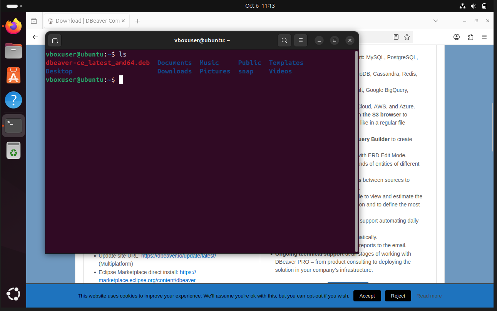
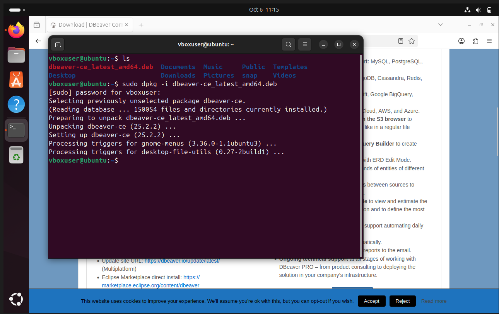

# Cara Instalasi DBeaver di Ubuntu

## 📌 Tentang Dokumentasi

Dokumentasi ini menjelaskan langkah-langkah instalasi **DBeaver Community Edition** pada sistem operasi Ubuntu menggunakan paket instalasi Linux Debian (`.deb`).

DBeaver merupakan aplikasi database management berbasis GUI (Graphical User Interface) yang dapat digunakan untuk menghubungkan, mengelola, dan menjalankan query pada berbagai jenis database, termasuk PostgreSQL.

---

## 🛠️ 1. Mengunduh DBeaver

1. Buka browser Mozilla Firefox.
2. Kunjungi situs resmi [DBeaver](https://dbeaver.io/).
3. Pilih menu **Download**.
4. Pada bagian Linux, pilih paket instalasi **Debian Package (.deb)**.
5. Klik kanan pada pilihan download, kemudian pilih **Copy Link** untuk menyalin alamat unduhan.



---

## 💻 2. Mengunduh Paket Instalasi melalui Terminal

Setelah mendapatkan tautan unduhan, buka Terminal Ubuntu.

Jalankan perintah berikut:

```bash
wget [URL_DOWNLOAD]
```

Ganti `[URL_DOWNLOAD]` dengan tautan yang sudah disalin dari halaman resmi DBeaver.

Contoh format perintah:

```bash
wget https://example.com/dbeaver-ce_latest_amd64.deb
```

> Catatan: URL pada contoh hanya ilustrasi. Gunakan tautan unduhan aktual dari situs resmi DBeaver.





---

## 📦 3. Memeriksa dan Menginstal DBeaver

Setelah proses download selesai, periksa file instalasi yang sudah diunduh menggunakan perintah:

```bash
ls
```

Cari nama file DBeaver dengan ekstensi `.deb`.

Selanjutnya, jalankan perintah instalasi:

```bash
sudo dpkg -i nama_file_dbeaver.deb
```

Ganti `nama_file_dbeaver.deb` dengan nama file yang sesuai dengan hasil download.

Contoh:

```bash
sudo dpkg -i dbeaver-ce_latest_amd64.deb
```

Masukkan password Ubuntu jika diminta, kemudian tunggu hingga proses instalasi selesai.

Jika terdapat pesan dependensi yang belum terpenuhi, jalankan:

```bash
sudo apt --fix-broken install
```

Perintah tersebut membantu memperbaiki dan memasang dependensi yang diperlukan.





---

## 🚀 4. Menjalankan Aplikasi DBeaver

Setelah instalasi berhasil:

1. Buka menu **Applications** pada Ubuntu.
2. Cari aplikasi **DBeaver**.
3. Klik ikon aplikasi untuk menjalankannya.
4. Tunggu hingga tampilan utama DBeaver terbuka.


---

## 🔗 5. Konfigurasi Koneksi PostgreSQL

Setelah DBeaver berhasil dijalankan, langkah berikutnya adalah menghubungkan aplikasi dengan server PostgreSQL.

**Prasyarat:** PostgreSQL harus sudah terinstal dan berjalan pada Ubuntu.

Jika belum melakukan instalasi PostgreSQL, silakan ikuti dokumentasi berikut:

[**Cara Instalasi PostgreSQL**](https://github.com/imammularif/DOCUMENTACI-UBUNTU-POSTGRESQL/blob/main/PostgreSQL-Setup-Configuration-on-Ubuntu/README.md)

### Langkah-langkah menghubungkan PostgreSQL:

1. Buka aplikasi DBeaver.
2. Pilih menu **New Database Connection**.
3. Pada daftar database, pilih **PostgreSQL**.
4. Masukkan konfigurasi koneksi sesuai pengaturan server PostgreSQL.

Parameter koneksi yang umumnya digunakan:

| Parameter | Keterangan |
|---|---|
| Host | `localhost` jika PostgreSQL berjalan pada komputer yang sama |
| Port | `5432` (port default PostgreSQL) |
| Database | Nama database yang akan dihubungkan |
| Username | Pengguna PostgreSQL yang sudah dibuat |
| Password | Password pengguna PostgreSQL |

5. Klik **Test Connection** untuk menguji koneksi.
6. Jika koneksi berhasil, lanjutkan dengan memilih **Finish**.


---

## ✅ 6. Selesai

Jika koneksi berhasil, PostgreSQL akan muncul pada panel Database Navigator di DBeaver.

Selanjutnya, kamu sudah dapat menggunakan DBeaver untuk:

- Melihat dan mengelola database.
- Membuat tabel dan struktur database.
- Menjalankan perintah SQL.
- Melakukan operasi CRUD.
- Memeriksa dan mengelola data melalui tampilan GUI.

---

## 📖 Kesimpulan

DBeaver mempermudah proses pengelolaan database PostgreSQL melalui antarmuka grafis tanpa harus selalu menjalankan perintah melalui Terminal.

Dengan menggabungkan PostgreSQL dan DBeaver, pengguna dapat mempelajari administrasi database sekaligus mempraktikkan penggunaan SQL secara lebih terstruktur.

**Selamat belajar dan bereksperimen dengan PostgreSQL!** 🚀
