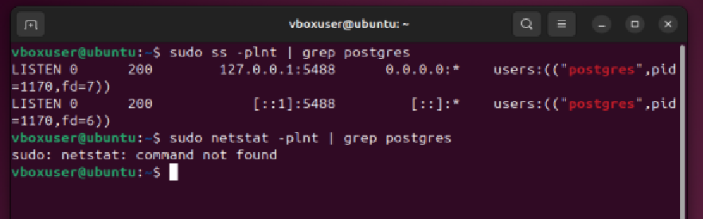

# PostgreSQL Installation, Setup & Configuration on Ubuntu

## 📌 Tentang Dokumentasi

Dokumentasi ini membahas proses instalasi, konfigurasi awal, serta pengaturan port PostgreSQL pada sistem operasi Ubuntu.

Panduan ini disusun untuk membantu memahami tahapan dasar dalam mempersiapkan PostgreSQL sebagai layanan database, mulai dari instalasi melalui Terminal, pengaturan password pengguna, hingga pemeriksaan port yang digunakan oleh PostgreSQL.

---

## 1. Instalasi PostgreSQL

### 1.1 Memperbarui Repository Ubuntu

Sebelum melakukan instalasi, perbarui daftar paket yang tersedia pada repository Ubuntu menggunakan perintah berikut:

```bash
sudo apt update
```

Perintah ini digunakan untuk memperbarui informasi paket agar sistem mendapatkan daftar versi paket terbaru yang tersedia.

### 1.2 Menginstal PostgreSQL

Jalankan perintah berikut untuk menginstal PostgreSQL beserta paket tambahannya:

```bash
sudo apt install postgresql postgresql-contrib
```

Keterangan:
- `postgresql`: Paket utama untuk instalasi PostgreSQL.
- `postgresql-contrib`: Paket tambahan yang menyediakan berbagai ekstensi dan utilitas PostgreSQL.

Tunggu hingga proses instalasi selesai.

### 1.3 Mengatur Password User PostgreSQL

Setelah instalasi selesai, PostgreSQL secara default menyediakan user administratif bernama `postgres`.

Untuk masuk menggunakan user tersebut, jalankan:

```bash
sudo -i -u postgres
```

Kemudian masuk ke PostgreSQL melalui terminal:

```bash
psql
```

Setelah berhasil masuk ke PostgreSQL, ubah password user `postgres` menggunakan perintah berikut:

```sql
ALTER USER postgres WITH PASSWORD 'GantiDenganPasswordKuat';
```

Ganti `GantiDenganPasswordKuat` dengan password yang kamu tentukan sendiri.

Alternatif lainnya, PostgreSQL menyediakan perintah berikut untuk mengubah password secara interaktif:

```text
\password postgres
```

Setelah selesai, keluar dari PostgreSQL menggunakan:

```text
\q
```

Kemudian keluar dari user `postgres`:

```bash
exit
```

> **Catatan:** Password diperlukan untuk autentikasi koneksi database, misalnya ketika menghubungkan PostgreSQL melalui DBeaver. Jangan menggunakan password contoh dalam dokumentasi sebagai password aktual. Hindari memublikasikan password asli ke repository publik.

### 1.4 Menghubungkan PostgreSQL dengan DBeaver

Setelah PostgreSQL terinstal dan password user sudah diatur, kamu dapat melanjutkan konfigurasi koneksi melalui DBeaver.

Dokumentasi instalasi dan konfigurasi DBeaver dapat dilihat melalui tautan berikut:

[Instalasi & konfigurasi DBeaver](https://github.com/imammularif/DOCUMENTASI-UBUNTU-POSTGRESQL/blob/main/Cara-Install-Dbeaver-di-Ubuntu/README.md)

Informasi koneksi default yang umum digunakan:

| Parameter | Nilai |
|---|---|
| Host | `localhost` |
| Port | `5432` |
| Database | `postgres` |
| Username | `postgres` |
| Password | Password yang sudah diatur sebelumnya |

---

## 2. Konfigurasi PostgreSQL (Opsional)

Bagian ini membahas konfigurasi dasar PostgreSQL, khususnya pemeriksaan versi dan pengaturan port koneksi.

### 2.1 Memeriksa Versi PostgreSQL

Untuk mengetahui versi PostgreSQL yang terinstal, jalankan:

```bash
psql --version
```

Alternatif lainnya, periksa direktori konfigurasi PostgreSQL:

```bash
ls /etc/postgresql/
```

Perintah tersebut akan menampilkan direktori versi PostgreSQL yang terpasang pada sistem.

### 2.2 Membuka File Konfigurasi PostgreSQL

File konfigurasi utama PostgreSQL berada di direktori:

```text
/etc/postgresql/<versi>/main/postgresql.conf
```

Ganti `<versi>` dengan versi PostgreSQL yang terinstal.

Contoh jika menggunakan PostgreSQL 16:

```bash
sudo nano /etc/postgresql/16/main/postgresql.conf
```

### 2.3 Mengubah Port PostgreSQL

Setelah file konfigurasi terbuka, cari parameter berikut:

```ini
#port = 5432
```

Hapus tanda komentar (`#`) jika masih ada, kemudian ubah port sesuai kebutuhan.

Contoh:

```ini
port = 5433
```

Keterangan:
- `5432` merupakan port default PostgreSQL.
- `5433` merupakan contoh port alternatif.
- Pastikan port yang digunakan tidak sedang dipakai oleh aplikasi atau service lain.

Setelah melakukan perubahan:

1. Tekan `Ctrl + X`.
2. Tekan `Y` untuk menyimpan perubahan.
3. Tekan `Enter` untuk mengonfirmasi nama file.

---

## 3. Restart Service PostgreSQL

Setelah mengubah konfigurasi, restart service PostgreSQL agar perubahan dapat diterapkan.

Jalankan perintah:

```bash
sudo systemctl restart postgresql
```

Untuk memeriksa status service PostgreSQL:

```bash
sudo systemctl status postgresql
```

Pastikan service PostgreSQL berjalan dengan status aktif.

---

## 4. Verifikasi Port PostgreSQL

Setelah service berhasil dijalankan kembali, lakukan pemeriksaan untuk mengetahui port yang sedang digunakan PostgreSQL.

### 4.1 Menggunakan Perintah `ss`

Jalankan perintah berikut:

```bash
sudo ss -plnt | grep postgres
```

Perintah ini digunakan untuk menampilkan informasi socket TCP yang sedang berada dalam status LISTEN, termasuk informasi proses yang menggunakannya.

Alternatifnya, kamu dapat memeriksa berdasarkan nomor port:

```bash
sudo ss -ltnp | grep 5433
```

Sesuaikan `5433` dengan port yang dikonfigurasi.

### 4.2 Menggunakan Perintah `netstat`

Selain `ss`, pemeriksaan port juga dapat dilakukan menggunakan `netstat`.

```bash
sudo netstat -plnt | grep postgres
```

Apabila perintah `netstat` tidak ditemukan, kemungkinan paket `net-tools` belum terinstal pada Ubuntu.

Untuk menginstalnya, jalankan:

```bash
sudo apt install net-tools
```

Setelah instalasi selesai, jalankan kembali perintah `netstat`.

### 4.3 Memverifikasi Port dari PostgreSQL

Pemeriksaan juga dapat dilakukan langsung melalui PostgreSQL.

Masuk ke PostgreSQL:

```bash
sudo -i -u postgres
psql
```

Kemudian jalankan query:

```sql
SHOW port;
```

PostgreSQL akan menampilkan nomor port yang sedang digunakan oleh server.



> **Catatan hasil praktik:** Pada dokumentasi screenshot di atas, port PostgreSQL terlihat menggunakan angka `5488`. Hal tersebut menunjukkan bahwa port telah diubah dari port default `5432`. Pastikan konfigurasi port pada DBeaver mengikuti port yang sedang digunakan oleh server PostgreSQL.

---

## 5. Kesimpulan

Melalui praktik ini, kita telah mempelajari beberapa tahapan dasar dalam mempersiapkan PostgreSQL di Ubuntu, yaitu:

1. Memperbarui repository dan menginstal PostgreSQL.
2. Mengakses PostgreSQL menggunakan user `postgres`.
3. Mengatur password untuk autentikasi database.
4. Mengenal file konfigurasi utama `postgresql.conf`.
5. Mengubah port PostgreSQL sesuai kebutuhan.
6. Melakukan restart dan pemeriksaan status service.
7. Memverifikasi port menggunakan `ss`, `netstat`, maupun query SQL.

Pemahaman terhadap instalasi dan konfigurasi dasar ini menjadi fondasi sebelum mempelajari pengelolaan database, manajemen pengguna dan hak akses, operasi CRUD, serta Backup & Restore.

**Selamat belajar dan bereksperimen dengan PostgreSQL!** 🚀
