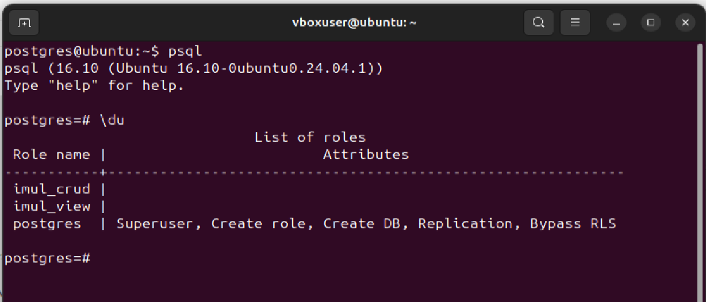
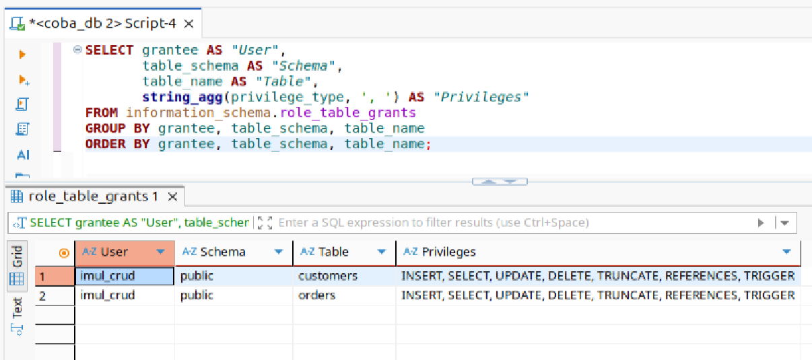

# PostgreSQL User Privileges Management (CRUD Access Control)

## 📌 Tentang Dokumentasi

Pada pengalaman kerja sebelumnya sebagai Technical Support, saya pernah terlibat dalam proses pengelolaan dan validasi data untuk kebutuhan user internal perusahaan menggunakan SQL.

Dari pengalaman tersebut, saya menyadari bahwa pengaturan hak akses pengguna merupakan salah satu aspek penting dalam pengelolaan database. Setiap pengguna sebaiknya hanya diberikan hak akses sesuai dengan kebutuhan dan tanggung jawabnya.

Berangkat dari hal tersebut, saya mulai mempelajari bagaimana membuat user, mengelola role, serta memberikan hak akses terhadap database dan tabel di PostgreSQL.

Mini project ini merupakan latihan untuk memahami penerapan **Database Access Control**, khususnya pengaturan hak akses CRUD (*Create, Read, Update, Delete*) menggunakan perintah SQL `GRANT` dan `ALTER DEFAULT PRIVILEGES`.

Dokumentasi ini juga menjadi bagian dari proses pembelajaran saya dalam memahami dasar-dasar **Database Administration** dan **Data Governance**.

---

## 1. Membuat User Baru

Langkah pertama adalah masuk menggunakan user administrator PostgreSQL, yaitu `postgres`.

Buka Terminal Ubuntu, kemudian jalankan:

```bash
sudo -i -u postgres
```

Selanjutnya, masuk ke PostgreSQL:

```bash
psql
```

Setelah berhasil masuk, buat user baru menggunakan perintah:

```sql
CREATE USER imul_crud WITH PASSWORD 'GantiDenganPasswordKuat';
```

Keterangan:
- `CREATE USER`: Membuat user atau role baru yang memiliki atribut LOGIN.
- `imul_crud`: Nama user yang dibuat.
- `PASSWORD`: Menentukan password untuk autentikasi user.

> **Catatan keamanan:** Gunakan password yang kuat dan jangan menyimpan password asli dalam repository publik.

---

## 2. Membuat Database dan Memberikan Hak Akses Koneksi

Pada tahap ini, terdapat dua skenario yang dapat digunakan sesuai kondisi database.

### 2.1 Membuat Database Baru

Jika database belum tersedia, administrator dapat membuat database sekaligus menetapkan pemiliknya menggunakan perintah:

```sql
CREATE DATABASE db_test OWNER imul_crud;
```

Keterangan:
- `db_test`: Nama database yang dibuat.
- `OWNER imul_crud`: Menetapkan `imul_crud` sebagai pemilik database.

Dengan cara ini, user `imul_crud` memiliki hak sebagai pemilik database tersebut.

### 2.2 Menggunakan Database yang Sudah Ada

Jika database sudah dibuat sebelumnya oleh administrator atau user lain, berikan hak akses koneksi menggunakan:

```sql
GRANT CONNECT ON DATABASE db_test TO imul_crud;
```

Perintah tersebut memberikan izin kepada user `imul_crud` untuk terhubung ke database `db_test`.

Untuk menggunakan database, user dapat melakukan koneksi melalui DBeaver atau PostgreSQL Terminal menggunakan kredensial yang sudah dibuat.

> **Catatan:** Hak `CONNECT` hanya memberikan izin untuk terhubung ke database. Hak akses terhadap schema, tabel, dan objek lainnya tetap perlu diatur secara terpisah.

---

## 3. Memberikan Hak Akses CRUD

Setelah user dan database tersedia, langkah selanjutnya adalah memberikan hak akses terhadap objek database.

### 3.1 Memberikan Hak Akses CRUD pada Semua Tabel yang Sudah Ada

Untuk memberikan hak akses `SELECT`, `INSERT`, `UPDATE`, dan `DELETE` pada seluruh tabel yang sudah tersedia di schema `public`, jalankan:

```sql
GRANT SELECT, INSERT, UPDATE, DELETE
ON ALL TABLES IN SCHEMA public
TO imul_crud;
```

Keterangan:

| Privilege | Fungsi |
|---|---|
| `SELECT` | Membaca atau mengambil data dari tabel. |
| `INSERT` | Menambahkan data baru ke tabel. |
| `UPDATE` | Memperbarui data yang sudah tersedia. |
| `DELETE` | Menghapus data dari tabel. |

### 3.2 Memberikan Hak Akses Berdasarkan Kebutuhan

Hak akses juga dapat diberikan secara spesifik sesuai kebutuhan pengguna.

**A. Hak akses SELECT saja**

```sql
GRANT SELECT
ON ALL TABLES IN SCHEMA public
TO imul_crud;
```

**B. Hak akses SELECT, INSERT, dan UPDATE**

```sql
GRANT SELECT, INSERT, UPDATE
ON ALL TABLES IN SCHEMA public
TO imul_crud;
```

**C. Hak akses CRUD lengkap**

```sql
GRANT SELECT, INSERT, UPDATE, DELETE
ON ALL TABLES IN SCHEMA public
TO imul_crud;
```

Pendekatan ini memungkinkan administrator menerapkan prinsip *Least Privilege*, yaitu memberikan hak akses seminimal mungkin sesuai kebutuhan pengguna.

### 3.3 Memberikan Hak Akses pada Schema

Selain hak akses terhadap tabel, user juga perlu mendapatkan hak `USAGE` pada schema agar dapat mengakses objek di dalamnya.

Jalankan:

```sql
GRANT USAGE ON SCHEMA public TO imul_crud;
```

Jika user juga membutuhkan izin untuk membuat objek baru seperti tabel pada schema tersebut, berikan hak `CREATE`:

```sql
GRANT CREATE ON SCHEMA public TO imul_crud;
```

Keterangan:
- `USAGE`: Mengizinkan user mengakses objek yang berada di dalam schema sesuai privilege objek yang dimiliki.
- `CREATE`: Mengizinkan user membuat objek baru di dalam schema.

> **Catatan:** `USAGE` dan `CREATE` memiliki fungsi berbeda. Hak `CREATE` tidak otomatis memberikan izin untuk membaca atau mengubah tabel yang sudah ada.

### 3.4 Memberikan Hak Akses pada SEQUENCE

Pada PostgreSQL, beberapa kolom menggunakan `SERIAL` atau sequence untuk menghasilkan nilai ID secara otomatis.

Agar user dapat melakukan operasi `INSERT` pada tabel yang menggunakan sequence, berikan hak akses berikut:

```sql
GRANT USAGE, SELECT
ON ALL SEQUENCES IN SCHEMA public
TO imul_crud;
```

Hak akses ini membantu user menggunakan sequence yang sudah tersedia di schema `public`.

### 3.5 Mengatur Default Privileges untuk Tabel Baru

Perintah `GRANT ON ALL TABLES` hanya berlaku untuk tabel yang sudah ada pada saat perintah dijalankan.

Jika terdapat tabel baru yang dibuat setelah pemberian hak akses, administrator dapat mengatur *Default Privileges* agar user tertentu memperoleh hak akses secara otomatis.

Contoh:

```sql
ALTER DEFAULT PRIVILEGES
IN SCHEMA public
GRANT SELECT, INSERT, UPDATE, DELETE
ON TABLES
TO imul_crud;
```

Untuk sequence yang dibuat kemudian:

```sql
ALTER DEFAULT PRIVILEGES
IN SCHEMA public
GRANT USAGE, SELECT
ON SEQUENCES
TO imul_crud;
```

> **Catatan penting:** `ALTER DEFAULT PRIVILEGES` berlaku untuk objek yang dibuat oleh role yang menjalankan perintah tersebut. Jika tabel dibuat oleh role administrator lain, pengaturan Default Privileges perlu dilakukan untuk role pembuat tabel tersebut. Pengaturan ini tidak otomatis berlaku untuk semua user atau seluruh objek yang dibuat oleh superuser.

---

## 4. Memeriksa User dan Hak Akses

Setelah seluruh konfigurasi selesai, administrator dapat melakukan pemeriksaan untuk memastikan user dan privilege sudah diberikan sesuai kebutuhan.

### 4.1 Memeriksa Daftar User dan Role

Gunakan perintah berikut melalui PostgreSQL Terminal:

```sql
\du
```

Perintah tersebut menampilkan daftar role PostgreSQL beserta atribut dan hak khusus yang dimilikinya.



### 4.2 Memeriksa Hak Akses Tabel Menggunakan SQL

Selain menggunakan perintah `\du`, pemeriksaan privilege tabel dapat dilakukan melalui SQL menggunakan view `information_schema.role_table_grants`.

Jalankan query berikut:

```sql
SELECT
    grantee AS "User",
    table_schema AS "Schema",
    table_name AS "Table",
    STRING_AGG(privilege_type, ', ') AS "Privileges"
FROM information_schema.role_table_grants
GROUP BY
    grantee,
    table_schema,
    table_name
ORDER BY
    grantee,
    table_schema,
    table_name;
```

Query tersebut digunakan untuk menampilkan informasi hak akses tabel, meliputi:
- Nama user atau role penerima privilege.
- Nama schema.
- Nama tabel.
- Jenis privilege yang diberikan.

> **Catatan:** `role_table_grants` menampilkan informasi privilege tabel berdasarkan cakupan akses role yang menjalankan query. Untuk pemeriksaan menyeluruh terhadap seluruh role, administrator dapat menggunakan katalog sistem PostgreSQL seperti `pg_roles` dan `pg_class` sesuai kebutuhan.

Berikut merupakan ilustrasi hasil pemeriksaan hak akses menggunakan user `imul_crud`.



---

## 5. Kesimpulan

Melalui mini project ini, saya mempelajari dasar pengelolaan user dan hak akses pada PostgreSQL, mulai dari pembuatan user hingga pemeriksaan privilege database.

Beberapa konsep yang dipelajari meliputi:

1. Membuat user atau role menggunakan `CREATE USER`.
2. Membuat database dan menetapkan pemilik menggunakan `CREATE DATABASE`.
3. Mengatur hak koneksi database menggunakan `GRANT CONNECT`.
4. Mengelola hak akses schema menggunakan `USAGE` dan `CREATE`.
5. Memberikan hak akses CRUD menggunakan `GRANT`.
6. Mengatur hak akses sequence.
7. Menerapkan `ALTER DEFAULT PRIVILEGES` untuk objek baru.
8. Memeriksa user dan privilege menggunakan perintah PostgreSQL serta SQL.

Pengaturan hak akses yang tepat merupakan bagian penting dalam menjaga keamanan, integritas, dan pengelolaan data di dalam sistem database.

---

## 💬 Catatan Penulis

Project ini dibuat sebagai latihan dan dokumentasi pribadi untuk memperdalam pemahaman mengenai pengelolaan hak akses user di PostgreSQL secara praktis.

Melalui latihan ini, saya mencoba memahami bagaimana administrator database mengatur akses pengguna berdasarkan kebutuhan operasional, serta bagaimana penerapan prinsip *Least Privilege* dapat membantu membatasi akses terhadap data.

Materi ini juga menjadi salah satu fondasi pembelajaran saya dalam bidang **Database Administration, Data Operations, dan Data Governance**.

Semoga dokumentasi sederhana ini dapat bermanfaat bagi teman-teman yang sedang mempelajari PostgreSQL. 🚀
