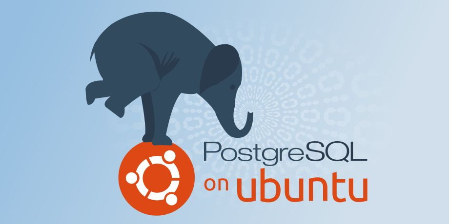
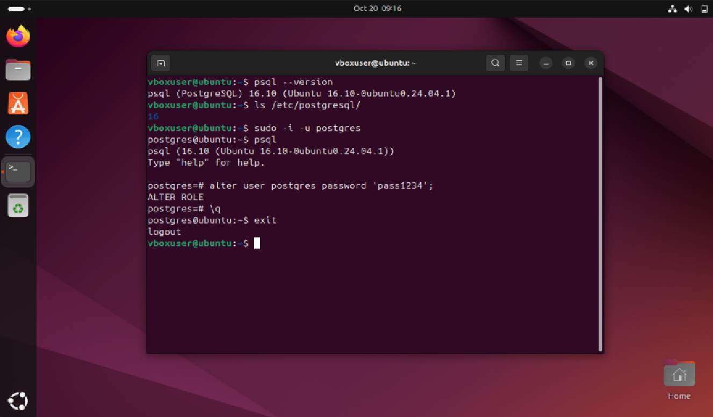
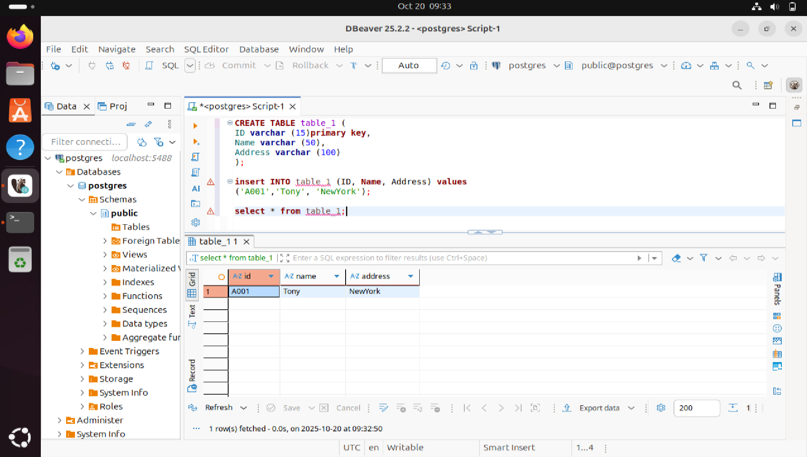
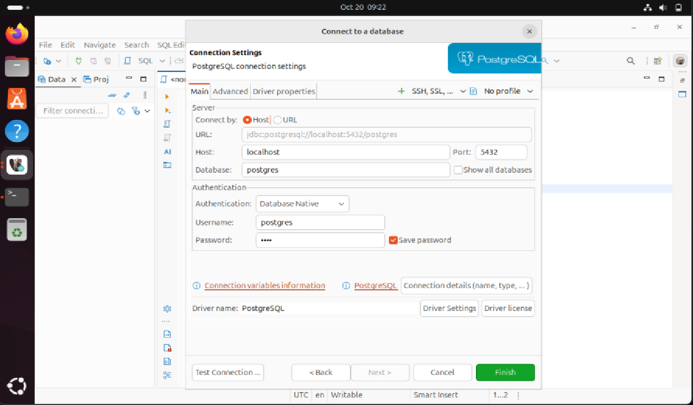

# 📘 Dokumentasi PostgreSQL di Ubuntu

Dokumentasi pembelajaran PostgreSQL yang mencakup proses instalasi, konfigurasi, pengelolaan database, hingga praktik dasar administrasi database menggunakan sistem operasi Ubuntu.

---

## 🖼️ Dokumentasi Proyek

---

## 📌 Tentang Repository

Repository ini berisi kumpulan dokumentasi dan praktik dasar dalam menggunakan **PostgreSQL** pada lingkungan Linux, khususnya Ubuntu.

Materi disusun secara bertahap untuk memahami bagaimana sebuah sistem database dipersiapkan, dikonfigurasi, dikelola, dan digunakan untuk menjalankan operasi pengolahan data.

Pembahasan meliputi instalasi PostgreSQL, konfigurasi koneksi, manajemen pengguna dan hak akses, operasi CRUD, serta proses pencadangan dan pemulihan database.

Repository ini dibuat sebagai dokumentasi pembelajaran sekaligus referensi praktik bagi siapa pun yang ingin mengenal PostgreSQL lebih dalam.

---

## 📷 Dokumentasi Praktik

Berikut beberapa tangkapan layar dari proses instalasi, konfigurasi, dan pengelolaan PostgreSQL di Ubuntu.

> Contoh proses penggunaan terminal Linux, eksekusi SQL melalui DBeaver, serta koneksi ke server PostgreSQL pada Ubuntu 22.04 LTS.

---

## 📚 Daftar Isi

| Materi | Deskripsi |
|---|---|
| [Instalasi PostgreSQL](https://github.com/imammularif/DOCUMENTASI-UBUNTU-POSTGRESQL/blob/main/PostgreSQL-Setup-Configuration-on-Ubuntu/README.md) | Panduan instalasi PostgreSQL pada sistem operasi Ubuntu. |
| [Konfigurasi Dasar](https://github.com/imammularif/DOCUMENTASI-UBUNTU-POSTGRESQL/blob/main/PostgreSQL-Setup-Configuration-on-Ubuntu/README.md#2-configurasi-postgresql-optional) | Pengaturan awal PostgreSQL, termasuk konfigurasi koneksi dan autentikasi. |
| [Manajemen Pengguna & Hak Akses](https://github.com/imammularif/DOCUMENTASI-UBUNTU-POSTGRESQL/blob/main/PostgreSQL-User-Privileges-Management/README.md) | Praktik membuat pengguna, mengelola role, dan mengatur privilege database. |
| [Operasi CRUD Sederhana](https://github.com/imammularif/DOCUMENTASI-UBUNTU-POSTGRESQL/blob/main/SimpleCRUD-PostgreSQL/README.md) | Implementasi operasi Create, Read, Update, dan Delete menggunakan SQL. |
| [Backup & Restore Database](https://github.com/imammularif/DOCUMENTASI-UBUNTU-POSTGRESQL/blob/main/backup-restore-postgreSQL/README.md) | Panduan pencadangan dan pemulihan database PostgreSQL. |
| [Instalasi DBeaver](https://github.com/imammularif/DOCUMENTASI-UBUNTU-POSTGRESQL/blob/main/Cara-Install-Dbeaver-di-Ubuntu/README.md) | Panduan instalasi DBeaver sebagai perangkat bantu pengelolaan database. |

---

## 🛠️ Teknologi dan Perangkat

| Teknologi | Kegunaan |
|---|---|
| **Ubuntu 22.04 LTS** | Sistem operasi dan lingkungan Linux untuk menjalankan PostgreSQL. |
| **PostgreSQL 16** | Relational Database Management System (RDBMS) untuk menyimpan dan mengelola data. |
| **DBeaver** | Perangkat berbasis GUI untuk mengakses database, menjalankan SQL, dan mengelola objek database. |
| **Linux Terminal** | Menjalankan perintah instalasi, konfigurasi, dan administrasi PostgreSQL. |
| **SQL** | Bahasa untuk membuat, membaca, memperbarui, dan menghapus data. |

---

## 🎯 Tujuan Pembelajaran

Melalui dokumentasi ini, tujuan pembelajaran yang ingin dicapai adalah:

1. Memahami proses instalasi dan konfigurasi PostgreSQL di lingkungan Linux.
2. Mengenal konsep dasar database dan Relational Database Management System (RDBMS).
3. Memahami pengelolaan pengguna, role, dan hak akses database.
4. Mempraktikkan operasi CRUD menggunakan SQL.
5. Memahami proses Backup & Restore untuk menjaga ketersediaan data.
6. Mengenal penggunaan DBeaver sebagai alat bantu administrasi dan pengelolaan database.

---

## 💡 Catatan Penting: Memahami Konsep RDBMS

Sebelum mempelajari SQL, PostgreSQL, MySQL, atau sistem database relasional lainnya, penting untuk memahami konsep dasar **Relational Database Management System (RDBMS)**.

Beberapa konsep yang perlu dipahami antara lain:

- Struktur tabel, baris, dan kolom.
- Tipe data dan batasan data (*data constraints*).
- Primary Key dan Foreign Key.
- Relasi antar tabel.
- Normalisasi database.
- Query untuk mengolah dan mengambil data.

Pemahaman terhadap konsep tersebut akan membantu dalam memahami bagaimana data disimpan, dihubungkan, dan dikelola dalam sebuah sistem database.

Sebagai langkah pembelajaran berikutnya, kamu juga bisa mengunjungi repository [**Basic SQL**](https://github.com/imammularif/Basic-SQL). Di sana terdapat latihan query SQL menggunakan studi kasus sederhana untuk memperkuat pemahaman mengenai struktur tabel, relasi, JOIN, dan pengolahan data.

Materi ini relevan sebagai fondasi awal bagi siapa pun yang ingin mengembangkan kemampuan di bidang **Data Analyst, Data Operations, Database Administration**, maupun bidang teknologi informasi lainnya.

---

## 💬 Catatan Penulis

Repository ini merupakan salah satu dokumentasi perjalanan belajar saya dalam memahami pengelolaan database menggunakan PostgreSQL di lingkungan Linux.

Melalui praktik ini, saya mencoba mengenal proses kerja database dari sisi teknis, mulai dari instalasi server, konfigurasi koneksi, pengelolaan pengguna dan hak akses, hingga menjalankan query SQL menggunakan perangkat bantu seperti DBeaver.

Dokumentasi ini juga menjadi pengenalan awal terhadap bagaimana database digunakan dalam sebuah sistem aplikasi. Dalam implementasi nyata, database dapat terhubung dengan aplikasi atau layanan backend melalui API untuk mendukung proses penyimpanan, pengambilan, dan pengelolaan data.

Bagi saya, latihan ini merupakan bagian dari proses membangun fondasi kemampuan di bidang **SQL, Data Management, dan Database Operations** sebelum mempelajari teknologi yang lebih kompleks, seperti Docker, cloud database, dan infrastruktur database berskala enterprise.

Ke depannya, dokumentasi ini masih berpotensi dikembangkan dengan materi tambahan serta eksplorasi perangkat lain seperti pgAdmin dan Docker.

Saya percaya bahwa pemahaman terhadap sistem yang kompleks selalu dimulai dari penguasaan konsep dan praktik dasar secara konsisten.

Semoga dokumentasi ini dapat bermanfaat bagi siapa pun yang sedang mempelajari PostgreSQL dan teknologi database.

---

## ℹ️ Informasi Dokumentasi

- **Sistem Operasi:** Ubuntu 22.04 LTS
- **Database Management System:** PostgreSQL 16
- **Database Client:** DBeaver
- **Bahasa Query:** SQL
- **Versi Dokumentasi:** 1.1
- **Pembaruan Terakhir:** Oktober 2025

> **Catatan:** Seluruh langkah dalam dokumentasi ini telah dicoba menggunakan Ubuntu 22.04 LTS dan PostgreSQL 16. Beberapa langkah mungkin memerlukan penyesuaian apabila menggunakan versi sistem operasi atau PostgreSQL yang berbeda.

**⚡ Keep calm and query on!** Jangan lupa melakukan Backup sebelum bereksperimen dengan database. 🚀
