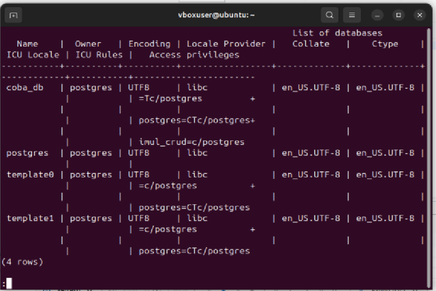
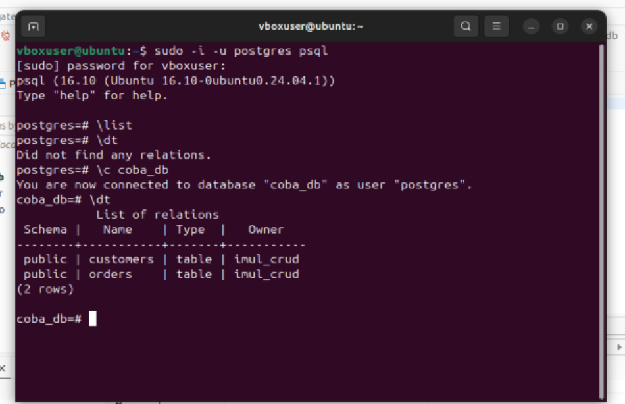
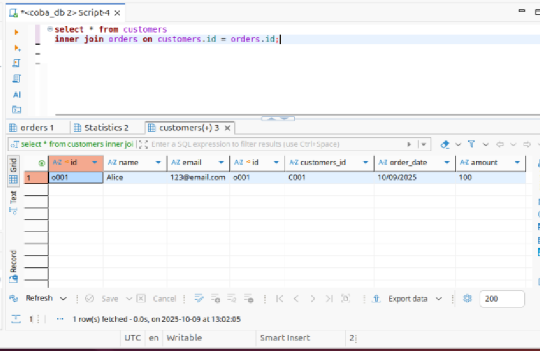
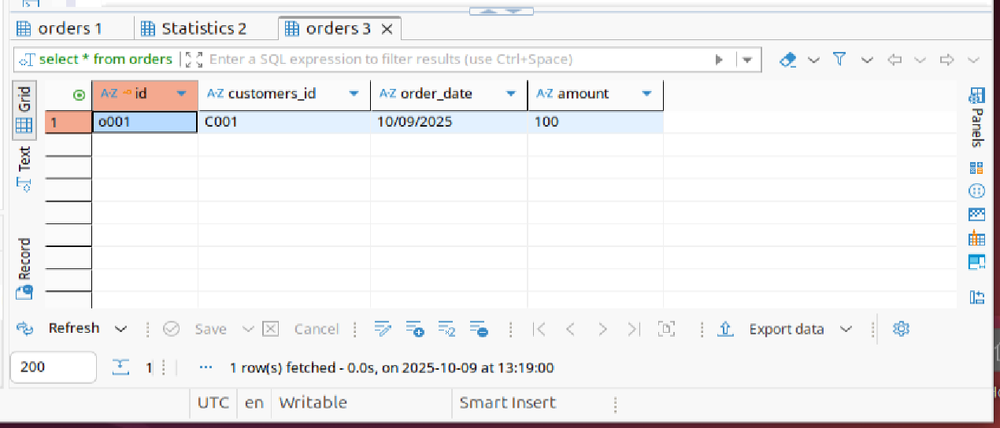
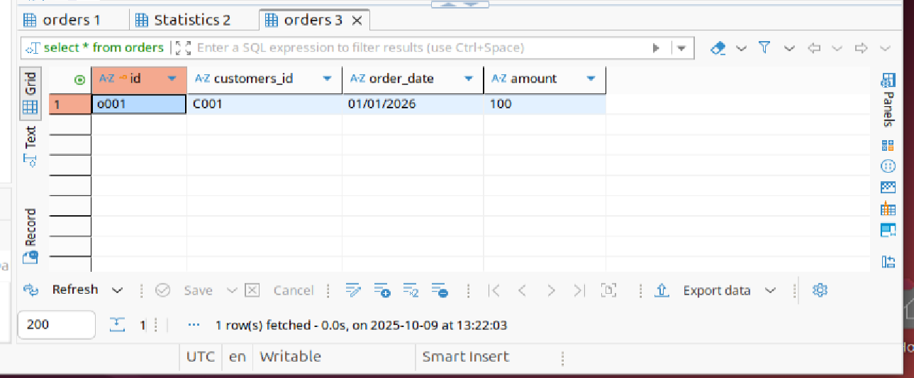
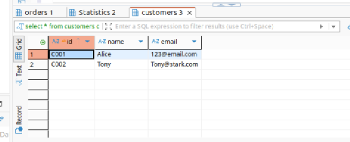
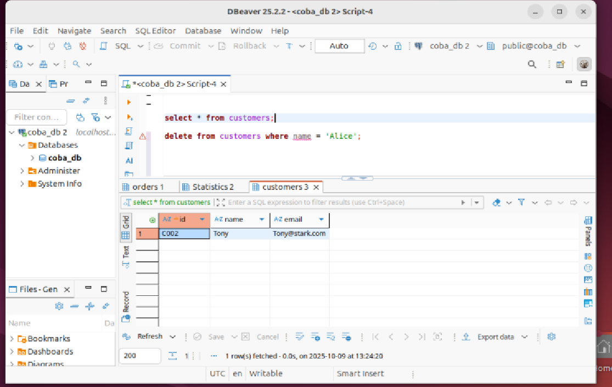

# Simple CRUD Operations in PostgreSQL

## 📌 Tentang Dokumentasi

Dokumentasi ini berisi praktik dasar pengelolaan database menggunakan PostgreSQL melalui aplikasi DBeaver.

Materi dimulai dari proses pembuatan database, pembuatan tabel, pengisian data, hingga penerapan operasi CRUD (*Create, Read, Update, Delete*).

Dalam praktik ini, saya menggunakan dua tabel sederhana, yaitu `customers` dan `orders`, untuk memahami bagaimana data disimpan dan dihubungkan melalui relasi antar tabel menggunakan `Primary Key`, `Foreign Key`, dan `JOIN`.

Dokumentasi ini dibuat sebagai latihan dasar untuk memahami proses pengolahan data menggunakan SQL pada PostgreSQL.

---

## 1. Membuka DBeaver dan Membuat Koneksi

Pastikan aplikasi DBeaver sudah terinstal pada Ubuntu.

Jika belum, silakan ikuti dokumentasi berikut:

[Cara Instalasi DBeaver](https://github.com/imammularif/DOCUMENTASI-UBUNTU-POSTGRESQL/blob/main/Cara-Install-Dbeaver-di-Ubuntu/README.md)

Selanjutnya:

1. Buka aplikasi DBeaver.
2. Buat koneksi baru dengan memilih PostgreSQL.
3. Masukkan konfigurasi koneksi sesuai server PostgreSQL.
4. Gunakan user `imul_crud` yang sudah dibuat pada dokumentasi manajemen hak akses sebelumnya, atau gunakan user administrator `postgres` jika diperlukan.
5. Klik **Test Connection** untuk memastikan koneksi berhasil.

Jika belum memahami proses pembuatan user dan pengaturan password, silakan lihat dokumentasi berikut:

[Konfigurasi PostgreSQL dan Pengaturan User](https://github.com/imammularif/DOCUMENTASI-UBUNTU-POSTGRESQL/tree/main/PostgreSQL-Setup-Configuration-on-Ubuntu#1-instalasi-postgresql)

---

## 2. Membuat Database

Setelah berhasil terhubung ke PostgreSQL, buka SQL Editor pada DBeaver.

Jalankan query berikut untuk membuat database baru:

```sql
CREATE DATABASE coba_db;
```

Database `coba_db` akan digunakan sebagai tempat penyimpanan tabel dan data dalam praktik ini.

### Memeriksa Database

Jika menggunakan PostgreSQL Terminal (`psql`), daftar database dapat diperiksa menggunakan perintah:

```sql
\l
```

atau:

```sql
\list
```

> **Catatan:** `\l` dan `\list` merupakan perintah khusus `psql` (meta-command), bukan SQL standar. Untuk DBeaver, database dapat dilihat melalui panel Database Navigator atau dengan menjalankan query SQL berikut:

```sql
SELECT datname
FROM pg_database
ORDER BY datname;
```



---

## 3. Membuat Tabel

Setelah database berhasil dibuat, hubungkan koneksi DBeaver ke database `coba_db`.

Selanjutnya, buat dua tabel yang akan digunakan dalam praktik ini:

- `customers`: Menyimpan informasi pelanggan.
- `orders`: Menyimpan informasi pesanan pelanggan.

### 3.1 Membuat Tabel Customers

Jalankan query berikut:

```sql
CREATE TABLE customers (
    id VARCHAR(10) PRIMARY KEY,
    name VARCHAR(50),
    email VARCHAR(100)
);
```

Keterangan:

| Kolom | Tipe Data | Fungsi |
|---|---|---|
| `id` | `VARCHAR(10)` | Identitas unik pelanggan dan Primary Key. |
| `name` | `VARCHAR(50)` | Menyimpan nama pelanggan. |
| `email` | `VARCHAR(100)` | Menyimpan alamat email pelanggan. |

### 3.2 Membuat Tabel Orders

Selanjutnya, buat tabel pesanan:

```sql
CREATE TABLE orders (
    id VARCHAR(10) PRIMARY KEY,
    customer_id VARCHAR(10) REFERENCES customers(id),
    order_date DATE,
    amount NUMERIC(12,2)
);
```

Keterangan:

| Kolom | Tipe Data | Fungsi |
|---|---|---|
| `id` | `VARCHAR(10)` | Identitas unik pesanan dan Primary Key. |
| `customer_id` | `VARCHAR(10)` | Foreign Key yang menghubungkan pesanan dengan pelanggan. |
| `order_date` | `DATE` | Menyimpan tanggal pesanan. |
| `amount` | `NUMERIC(12,2)` | Menyimpan nominal pesanan. |

Pada tabel `orders`, kolom `customer_id` berfungsi sebagai **Foreign Key** yang mengacu pada kolom `id` di tabel `customers`.

Dengan demikian, satu pelanggan dapat memiliki beberapa pesanan.

### 3.3 Memeriksa Tabel

Jika menggunakan PostgreSQL Terminal (`psql`), hubungkan terlebih dahulu ke database:

```sql
\c coba_db
```

Kemudian periksa daftar tabel:

```sql
\dt
```

> **Catatan:** `\c` dan `\dt` merupakan meta-command khusus `psql`. Di DBeaver, tabel juga dapat diperiksa melalui Database Navigator dengan membuka database `coba_db` kemudian memilih schema `public` dan folder Tables.



---

## 4. Memasukkan Data (INSERT)

Setelah tabel berhasil dibuat, langkah berikutnya adalah memasukkan data ke masing-masing tabel.

### 4.1 Insert Data ke Tabel Customers

```sql
INSERT INTO customers (id, name, email)
VALUES ('C001', 'Alice', '123@email.com');
```

Query tersebut menambahkan satu data pelanggan dengan informasi:
- ID: `C001`
- Nama: `Alice`
- Email: `123@email.com`

### 4.2 Insert Data ke Tabel Orders

```sql
INSERT INTO orders (id, customer_id, order_date, amount)
VALUES ('O001', 'C001', '2025-09-10', 100);
```

Query tersebut menambahkan satu data pesanan yang terhubung dengan pelanggan `C001`.

> **Catatan:** Format tanggal yang digunakan adalah `YYYY-MM-DD`, sedangkan kolom `amount` menggunakan tipe data numerik agar dapat digunakan dalam perhitungan.

---

## 5. Praktik Operasi CRUD

CRUD merupakan empat operasi dasar yang digunakan untuk mengelola data dalam database.

CRUD terdiri dari:

- **Create:** Menambahkan data baru.
- **Read:** Membaca atau menampilkan data.
- **Update:** Memperbarui data.
- **Delete:** Menghapus data.

### 5.1 READ – Menampilkan Data

Untuk menampilkan seluruh data pada tabel `customers`, gunakan:

```sql
SELECT * FROM customers;
```

Untuk menampilkan data pada tabel `orders`:

```sql
SELECT * FROM orders;
```

### 5.2 READ – Menggabungkan Data Menggunakan JOIN

Selain menampilkan data dari masing-masing tabel, kita juga dapat menggabungkan data menggunakan `JOIN`.

Dalam praktik ini, digunakan `INNER JOIN` untuk menampilkan pelanggan beserta pesanan yang memiliki hubungan berdasarkan `customer_id`.

```sql
SELECT
    customers.id,
    customers.name,
    customers.email,
    orders.id AS order_id,
    orders.order_date,
    orders.amount
FROM customers
INNER JOIN orders
    ON customers.id = orders.customer_id;
```

Keterangan:

- `INNER JOIN`: Menggabungkan data dari dua tabel berdasarkan kondisi relasi yang ditentukan.
- `customers.id`: Primary Key pada tabel pelanggan.
- `orders.customer_id`: Foreign Key pada tabel pesanan.

Hasilnya hanya menampilkan pelanggan yang memiliki data pesanan yang sesuai.



### 5.3 CREATE – Menambahkan Data Baru

Selanjutnya, tambahkan satu data pelanggan baru ke tabel `customers`:

```sql
INSERT INTO customers (id, name, email)
VALUES ('C002', 'Tony', 'Tony@stark.com');
```

Query tersebut akan menambahkan pelanggan baru dengan ID `C002`.

### 5.4 UPDATE – Memperbarui Data

Pada tahap ini, kita akan memperbarui tanggal pesanan pada tabel `orders`.

Data awal memiliki tanggal `2025-09-10`, kemudian akan diubah menjadi `2026-01-01`.

Jalankan query berikut:

```sql
UPDATE orders
SET order_date = '2026-01-01'
WHERE id = 'O001';
```

Keterangan:

- `UPDATE orders`: Menentukan tabel yang akan diperbarui.
- `SET order_date`: Menentukan kolom yang akan diubah.
- `WHERE id = 'O001'`: Menentukan data pesanan yang ingin diperbarui.

> **Catatan:** Penggunaan `WHERE` sangat penting agar perubahan hanya diterapkan pada data yang dituju.

**Sebelum Update**



**Sesudah Update**



### 5.5 DELETE – Menghapus Data

Selanjutnya, kita akan menghapus pelanggan dengan nama `Alice` dari tabel `customers`.

Namun, karena pelanggan `Alice` masih memiliki pesanan di tabel `orders`, data pesanan tersebut harus dihapus terlebih dahulu agar tidak melanggar aturan Foreign Key.

**Langkah pertama: Hapus data pesanan Alice.**

```sql
DELETE FROM orders
WHERE customer_id = 'C001';
```

**Langkah kedua: Hapus data pelanggan Alice.**

```sql
DELETE FROM customers
WHERE name = 'Alice';
```

Keterangan:

- `DELETE FROM`: Menghapus data dari tabel.
- `WHERE`: Menentukan data yang akan dihapus.

> **Catatan:** Penghapusan data pesanan terlebih dahulu dilakukan karena hubungan Foreign Key pada tabel `orders` mengacu pada tabel `customers`. Secara default, PostgreSQL akan mencegah penghapusan data pelanggan yang masih direferensikan oleh tabel lain.

**Sebelum Delete**



**Sesudah Delete**



---

## 6. Referensi Pembelajaran

Untuk mempelajari SQL dan PostgreSQL lebih lanjut, kamu dapat mengunjungi dokumentasi berikut:

[Belajar PostgreSQL – W3Schools](https://www.w3schools.com/postgresql/index.php)

Selain itu, kamu juga dapat memanfaatkan berbagai sumber pembelajaran lain seperti dokumentasi resmi PostgreSQL, artikel teknis, maupun video tutorial.

---

## 7. Kesimpulan

Melalui praktik sederhana ini, saya mempelajari bagaimana membangun database relasional menggunakan PostgreSQL dan menjalankan operasi CRUD untuk mengelola data.

Beberapa konsep yang dipelajari meliputi:

1. Membuat database menggunakan `CREATE DATABASE`.
2. Membuat tabel menggunakan `CREATE TABLE`.
3. Menentukan Primary Key dan Foreign Key.
4. Memasukkan data menggunakan `INSERT`.
5. Menampilkan data menggunakan `SELECT`.
6. Menggabungkan tabel menggunakan `INNER JOIN`.
7. Memperbarui data menggunakan `UPDATE`.
8. Menghapus data menggunakan `DELETE`.

Praktik ini menjadi fondasi awal untuk memahami bagaimana data disimpan, dihubungkan, dan dikelola menggunakan SQL dalam sebuah sistem database relasional.

---

## 💬 Catatan Penulis

Dokumentasi ini merupakan bagian dari proses pembelajaran saya dalam memahami PostgreSQL dan penerapan SQL untuk pengelolaan data.

Melalui mini project ini, saya mencoba mempraktikkan konsep dasar database relasional menggunakan studi kasus sederhana yang terdiri dari tabel pelanggan dan pesanan.

Tentunya, dokumentasi ini masih merupakan latihan dasar dan masih banyak hal yang perlu dipelajari lebih lanjut, khususnya mengenai relasi antar tabel, optimasi query, transaksi database, dan pengelolaan data dalam skala yang lebih besar.

Semoga dokumentasi ini dapat bermanfaat bagi teman-teman yang sedang mempelajari SQL dan PostgreSQL.

**#TetapBelajar #DataAnalyst #PostgreSQL #SQL** 🚀
