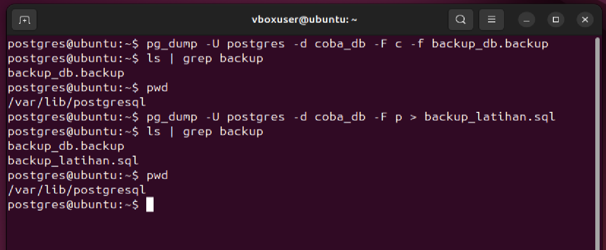

# PostgreSQL Backup & Restore

## 📌 Tentang Dokumentasi

Untuk memperdalam pemahaman mengenai pengelolaan database, saya mempelajari proses **Backup & Restore** pada PostgreSQL.

Backup merupakan proses pencadangan database untuk menyimpan salinan data sebagai langkah antisipasi terhadap kehilangan atau kerusakan data. Sementara itu, Restore merupakan proses mengembalikan database dari file backup yang telah dibuat sebelumnya.

Dalam praktik ini, saya mempelajari penggunaan beberapa utilitas PostgreSQL, yaitu:

- `pg_dump`: Membuat backup database.
- `pg_restore`: Memulihkan database dari backup dengan format custom, directory, atau tar.
- `psql`: Menjalankan file SQL untuk memulihkan database dalam format plain SQL.

Dokumentasi ini dibuat sebagai latihan sekaligus referensi praktis untuk memahami proses pencadangan dan pemulihan database PostgreSQL melalui Terminal Linux.

---

# 1. BACKUP DATABASE

## 1.1 Masuk ke User Administrator PostgreSQL

Buka Terminal Ubuntu, kemudian masuk menggunakan user administrator PostgreSQL:

```bash
sudo -i -u postgres
```

Perintah tersebut digunakan untuk berpindah ke user sistem `postgres`, sehingga proses administrasi database dapat dilakukan menggunakan akun tersebut.

## 1.2 Melakukan Backup Database

PostgreSQL menyediakan utilitas `pg_dump` untuk membuat salinan atau backup sebuah database.

Terdapat beberapa format backup yang dapat digunakan.

### A. Backup dengan Format Custom

Format custom menggunakan parameter `-F c`. Format ini dapat dipulihkan menggunakan `pg_restore`.

Contoh perintah:

```bash
pg_dump -U postgres -d coba_db -F c -f backup_latihan.backup
```

Keterangan:

| Parameter | Fungsi |
|---|---|
| `pg_dump` | Utilitas untuk melakukan backup database. |
| `-U postgres` | Menentukan user PostgreSQL yang digunakan. |
| `-d coba_db` | Menentukan database yang akan dicadangkan. |
| `-F c` | Menggunakan format custom. |
| `-f` | Menentukan nama file hasil backup. |

### B. Backup dengan Format Plain SQL

Selain format custom, backup dapat disimpan dalam bentuk file SQL menggunakan format plain (`-F p`).

```bash
pg_dump -U postgres -d coba_db -F p -f backup_latihan.sql
```

File tersebut berisi kumpulan perintah SQL yang dapat dijalankan kembali menggunakan `psql`.

> **Catatan:** Jika perintah dijalankan sebagai user sistem `postgres`, autentikasi lokal biasanya dapat menggunakan mekanisme peer authentication. Jika menemui kesalahan autentikasi, periksa konfigurasi koneksi PostgreSQL dan metode autentikasinya.

## 1.3 Memeriksa File Backup

Setelah proses backup selesai, periksa file yang sudah dibuat menggunakan:

```bash
ls | grep backup
```

Perintah tersebut digunakan untuk mencari file yang memiliki kata `backup` pada nama filenya.

## 1.4 Memeriksa Lokasi Penyimpanan File

Untuk mengetahui direktori aktif tempat file backup disimpan, gunakan:

```bash
pwd
```

Perintah ini menampilkan lokasi direktori kerja saat ini.

Jika proses dijalankan setelah berpindah ke user sistem `postgres`, file backup akan tersimpan pada direktori kerja user tersebut apabila tidak menentukan lokasi file secara spesifik.



---

# 2. RESTORE DATABASE

Setelah file backup berhasil dibuat, langkah berikutnya adalah melakukan Restore untuk mengembalikan database.

Proses Restore menggunakan perintah yang berbeda, bergantung pada format file backup yang digunakan.

## 2.1 Membuka Terminal dan Masuk ke PostgreSQL

Buka Terminal Ubuntu, kemudian jalankan:

```bash
sudo -i -u postgres
```

Selanjutnya, masuk ke PostgreSQL menggunakan:

```bash
psql
```

## 2.2 Menghapus Database Lama (Opsional)

Jika database tujuan sudah tersedia dan ingin dibuat ulang, database lama dapat dihapus terlebih dahulu.

Namun, sebelum menghapus database, pastikan koneksi PostgreSQL tidak sedang berada di database yang akan dihapus.

Contohnya, jika ingin menghapus database `coba_db`, jalankan perintah dari database lain, misalnya database `postgres`.

```sql
DROP DATABASE IF EXISTS coba_db;
```

> **Peringatan:** Perintah tersebut akan menghapus database beserta seluruh objek dan data di dalamnya. Pastikan sudah memiliki file backup yang valid sebelum melanjutkan.

## 2.3 Membuat Database Baru

Setelah database lama dihapus, buat database baru sebagai tujuan Restore:

```sql
CREATE DATABASE coba_db;
```

Keluar dari PostgreSQL menggunakan:

```text
\q
```

Pastikan database tujuan sudah tersedia sebelum melakukan proses Restore.

---

## 2.4 Restore Menggunakan File Plain SQL (.sql)

Jika file backup menggunakan format plain SQL, proses Restore dapat dilakukan menggunakan utilitas `psql`.

Contoh:

```bash
psql -U postgres -d coba_db -f backup_latihan.sql
```

Keterangan:

| Parameter | Fungsi |
|---|---|
| `psql` | Utilitas untuk menjalankan perintah SQL. |
| `-U postgres` | User PostgreSQL yang digunakan. |
| `-d coba_db` | Database tujuan Restore. |
| `-f backup_latihan.sql` | File SQL yang akan dijalankan. |

Pastikan file backup berada di direktori aktif atau gunakan lokasi file secara lengkap.

---

## 2.5 Restore Menggunakan File Custom (.backup)

Jika sebelumnya melakukan backup menggunakan format custom (`-F c`), proses Restore dilakukan menggunakan `pg_restore`.

Contoh:

```bash
pg_restore -U postgres -d coba_db backup_latihan.backup
```

Keterangan:

| Parameter | Fungsi |
|---|---|
| `pg_restore` | Utilitas untuk memulihkan backup dalam format yang didukung. |
| `-U postgres` | User PostgreSQL yang digunakan. |
| `-d coba_db` | Database tujuan Restore. |
| `backup_latihan.backup` | File backup yang akan dipulihkan. |

Jika file backup berada di direktori berbeda, gunakan lokasi file secara lengkap.

> **Catatan:** Database tujuan harus sudah dibuat sebelum menjalankan perintah di atas. Untuk format custom, `pg_restore` akan memulihkan objek dan data yang tersimpan dalam arsip backup.

---

# 3. Perbedaan pg_dump, pg_restore, dan psql

Berikut ringkasan fungsi utilitas yang digunakan dalam dokumentasi ini:

| Utilitas | Fungsi |
|---|---|
| `pg_dump` | Membuat backup database PostgreSQL. |
| `pg_restore` | Memulihkan backup dengan format custom, directory, atau tar. |
| `psql` | Menjalankan perintah SQL, termasuk memulihkan file plain SQL. |

Perbedaan format backup:

| Format | Ekstensi contoh | Proses Restore |
|---|---|---|
| Custom | `.backup` | `pg_restore` |
| Plain SQL | `.sql` | `psql` |
| Tar | `.tar` | `pg_restore` |

---

# 4. Kesimpulan

Melalui praktik ini, saya mempelajari proses dasar pencadangan dan pemulihan database menggunakan PostgreSQL.

Beberapa hal yang dipelajari meliputi:

1. Mengakses PostgreSQL menggunakan user administrator.
2. Membuat backup database menggunakan `pg_dump`.
3. Mengenal format backup Custom dan Plain SQL.
4. Memeriksa file hasil backup dan lokasi penyimpanannya.
5. Menyiapkan database tujuan Restore.
6. Memulihkan database menggunakan `pg_restore`.
7. Menjalankan file SQL menggunakan `psql`.

Backup & Restore merupakan salah satu bagian penting dalam pengelolaan database karena membantu menjaga ketersediaan dan keberlangsungan data.

---

## 💬 Catatan Penulis

Dokumentasi ini merupakan bagian dari proses pembelajaran saya dalam memahami administrasi database PostgreSQL, khususnya mengenai pencadangan dan pemulihan data.

Melalui praktik ini, saya mencoba memahami bagaimana database dapat dicadangkan, disimpan, dan dipulihkan kembali ketika diperlukan.

Pemahaman mengenai Backup & Restore menjadi salah satu fondasi penting dalam bidang **Database Administration, Data Operations, dan Database Management**.

Semoga dokumentasi sederhana ini dapat bermanfaat bagi teman-teman yang sedang mempelajari PostgreSQL.

**Keep learning, keep querying, and always backup your database!** 🚀
